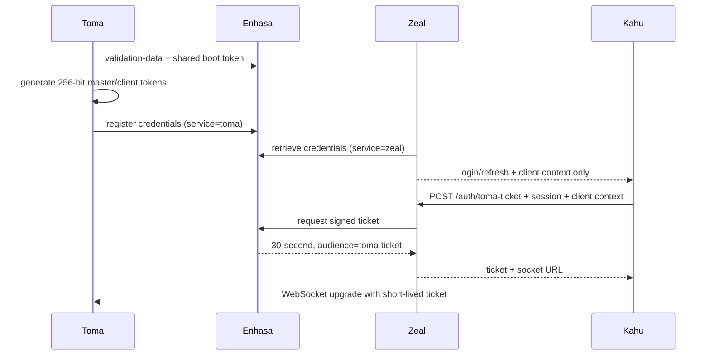

# Toma

Toma is Kahu's tenant-scoped real-time invalidation service. Zeal remains authoritative; Toma holds only active sockets and short-lived pending deliveries in process memory.

## Boundaries

- **Enhasa** authenticates users, distributes JWT validation material, stores the current process-lifetime Toma credentials in memory, and signs short-lived socket tickets.
- **Zeal** commits business state, selects exact tenant operators, publishes with the master token, and exposes only the client context to Kahu.
- **Toma** authenticates publications and socket tickets, routes by ticket-derived tenant/operator identity, retries pending deliveries until TTL, and tracks operator ACKs.
- **Kahu** receives invalidations, acknowledges them, deduplicates IDs/revisions, and resynchronizes the affected scope from Zeal.

## Authentication



Raw process credentials never appear in health, readiness, metrics, socket messages, or logs. Enhasa keeps them only in memory. The service-name header separates operations but is not an independent credential: security ultimately depends on the existing shared boot token. This is the principal limitation of the current Enhasa trust model.

## Publication and delivery

```mermaid
sequenceDiagram
  participant DB as PostgreSQL
  participant Z as Zeal
  participant T as Toma
  participant K as Kahu
  Z->>DB: commit business mutation
  DB-->>Z: committed
  Z->>T: publish tenant + exact operator IDs
  T-->>K: notification to every active session
  K->>K: invalidate/refetch scope
  K->>T: ACK notification ID
  T->>T: complete operator; delete when all ACK
```

Delivery is temporary, operator-addressed, at least once. One ACK from any current session completes an operator. Disconnected operators remain pending and receive retries on reconnect. Expired or completed notifications are deleted. A restart loses all pending state; clients resynchronize from Zeal after reconnect. There is no durable queue and no all-or-none network delivery.

Kanban events may opt into coalescing by tenant, operator, event type, and scope. A lower revision cannot replace a higher revision.

## Rotation

Every Toma start creates new master/client tokens and atomically replaces Enhasa's in-memory record. Zeal caches credentials in memory, invalidates on Toma 401, refreshes through one single-flight request, and retries once. Kahu presents its current client context when requesting a ticket; obsolete context returns 409, causing one session refresh before reconnect. Reconnect uses bounded exponential backoff with jitter.

## API

- `GET /liveness`: process/server liveness.
- `GET /readiness`: Enhasa bootstrap and credential readiness.
- `POST /internal/v1/notifications`: master-authenticated publication.
- `GET /internal/v1/metrics`: master-authenticated low-cardinality metrics.
- `GET /v1/socket?ticket=<short-lived-ticket>`: WebSocket upgrade.

Inbound frames and payloads are capped, strict schemas reject unknown fields, compression is disabled, slow sockets are closed, and ACK/connection/publish attempts are rate-limited.

## Local development

1. Configure `.env.development`, `.env.test`, or `.env.production` from `.env.example`; use a `.local` override for machine-specific values.
2. Use exactly the same `<ENV>_ENHASA_BOOT_TOKEN` configured in Zeal.
3. Start Enhasa first, then Toma, Zeal, and Kahu.
4. Run `npm run dev`.

Defaults: port 3003, 60-second TTL, 1-second minimum, 5-minute maximum, 16 KiB payload/frame limit, 256 KiB socket backpressure threshold.

## Tests

`npm test` runs deterministic, injectable-clock delivery tests. `npm run typecheck` and `npm run build` validate the service.

## Current limitations

- Pending state and Enhasa's current Toma credentials are process-memory only. Restarting Enhasa requires Toma to register again.
- The first Kanban publisher is the presale-item mutation flow; additional authoritative modules must call `tomaService.publish` after commit.
- Metrics are JSON rather than Prometheus exposition.
- The shared boot token cannot cryptographically distinguish Toma from Zeal; per-service workload identities are a future hardening step.

### Environment files

Local configuration uses ignored mode files: `.env.development`, `.env.test`, and `.env.production`. Select the mode with `APP_ENV` (or `NODE_ENV` as a fallback). Resolution priority is process environment, `.env.<mode>.local`, `.env.local`, `.env.<mode>`, then legacy `.env`. `.env.example` documents keys only and is never loaded. Real mode files must not be committed.
